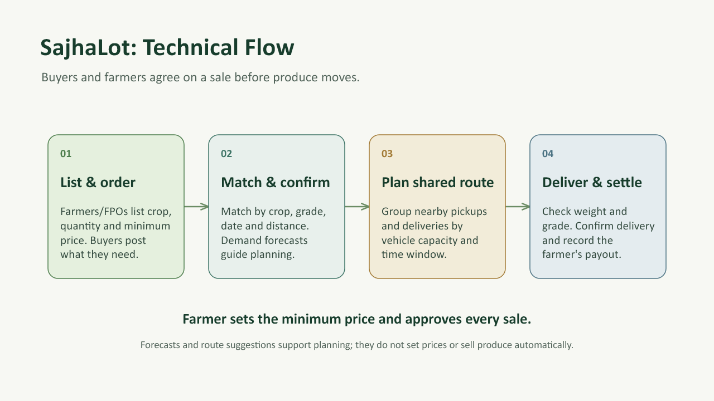

# Smart India Hackathon Workshop
# Date:25 November 2026
## Reference Number:26006601
## Name:N.M.SANTHOSH

## Problem Title
SIH 26033: Multiple intermediaries reduce farmers earnings and increase consumer prices.

## Problem Creater's Organization
Ministry of Consumer Affairs, Food & Public Distribution

## Theme
Agriculture, FoodTech & Rural Development

## Problem Description
Expected Solution: Create a digital marketplace that:

• Connects farmers/FPOs directly with consumers and bulk buyers.
• Provides logistics support.
• Uses AI for demand forecasting and route optimization.

Benefits:

• Better prices for farmers.
• Lower prices for consumers.
• Reduced supply chain inefficiencies.

## Proposed Solution
### SajhaLot — shared orders and delivery for local produce

I propose SajhaLot, a platform that helps farmers and nearby buyers plan a sale before produce is moved. Farmers or their Farmer Producer Organization (FPO) list the crop, quantity, expected harvest date, location, grade if known, and the minimum price they are willing to accept. Buyers such as grocers, hostels, restaurants, housing-society groups, and small processors post the quantity and delivery date they need.

SajhaLot groups orders and available produce by crop, grade, date, and distance. It shows the farmer or FPO the expected payout after each service and transport charge. The farmer or FPO decides whether to accept an offer. If the offer is below the farmer's minimum price, the system does not make the sale.

Once an offer is accepted, the produce is checked and weighed at an FPO collection point or another agreed location. A route planner groups nearby pickups and deliveries into shared vehicle trips. When the buyer receives the produce, the platform records delivery and gives the farmer or FPO an itemized settlement statement. Households can join a shared neighborhood basket and collect it from one nearby drop point.

### How it addresses the problem

- Farmers and buyers can coordinate directly, with required mandi, APMC, FPO, and other approved processes kept in place.
- Farmers can compare offers and see their expected net payout before accepting a sale.
- Several small farm lots can be combined to meet a buyer's order.
- Several buyer orders can share one route, spreading transport cost over more produce.
- Farmers can use a local-language mobile page or get help from an FPO operator. A smartphone is not required to list produce.

A digital marketplace by itself cannot remove every intermediary because grading, transport, aggregation, and market services are still needed. SajhaLot makes these roles and fees visible and helps coordinate them. Where required and permitted, a confirmed trade can use an approved mandi or e-trading process.

### What is different about my idea

The main feature is that the buyer's requirement and the farmer's available produce are planned together before dispatch. This can reduce the risk of moving produce first and searching for a buyer later. A farmer-set minimum price protects the farmer from an offer they do not want to accept. Grouping neighborhood orders also makes small consumer purchases easier to deliver efficiently. Forecasts only help with planning; they cannot set the farmer's price or approve a sale.

## Technical Approach 

| Component | Proposed technology or method |
|---|---|
| Farmer, FPO, and buyer screens | Local-language responsive web app, plus an assisted dashboard at an FPO or collection point and phone/SMS support. |
| Application service | Python with FastAPI for listings, matching, orders, dispatch, and settlement records. |
| Data store | PostgreSQL with PostGIS to store orders and group them by location. Contact details are private and visible only to authorized users. |
| Demand planning | Start with seasonal patterns and moving averages from confirmed orders and local crop calendars. When enough reliable data is available, test a time-series model. Show estimates as estimates and allow a person to review them. |
| Order matching | Rules compare crop, grade, date, distance, quantity, and the farmer's minimum price. Participants can revise or withdraw unmatched offers. |
| Route planning | Google OR-Tools can suggest routes using vehicle capacity, delivery time windows, distance, and product handling needs. A dispatcher checks the route before confirming it. |
| Payments | Use a bank or authorized payment provider. SajhaLot records the payment reference and settlement details; it does not hold customer funds. |
| Existing market workflows | Export lot, quality, invoice, and dispatch records. Connect to an approved mandi or e-trading process only where permitted. |

### Implementation plan

1. Choose one district and work with an FPO, a few buyers, a transporter, and a local market or agriculture contact to understand crops, quality checks, collection points, and applicable rules.
2. Build the first version with listings, buyer order windows, farmer-set minimum prices, net-payout estimates, manual match review, and order tracking.
3. Add shared route suggestions for confirmed orders. Compare the suggestions with routes planned by a local dispatcher.
4. Run a small pilot with a few FPOs and repeat buyers. Keep phone support and manual handling for poor connectivity, quality disputes, or route changes.
5. Compare the results with same-period, same-grade local market prices before expanding to another district.

## Feasibility and Viability
The first version can run on smartphones and an FPO computer. It needs a web service, a database, and local transport, but no new warehouse or custom hardware. The first pilot can use manual quality checks and a simple seasonal forecast. A dispatcher can check all route suggestions before they are used.

The platform can be run by an FPO or local cooperative/market partner. Possible revenue sources are a disclosed per-order coordination fee, a buyer subscription for regular procurement tools, or an agreed logistics coordination fee. The farmer sees deductions and the expected payout before accepting an offer.
Challenges and mitigation

| Challenge | How I would address it |
|---|---|
| Forecasts are weak at the start | Use a seasonal baseline and confirmed buyer orders; label forecasts as estimates and require buyer confirmation. |
| Buyer or seller cancels | Confirm quantities by phone or through the FPO, record cancellations, and keep a manual backup process. |
| Grade or weight is disputed | Agree on grade before matching, record weight at collection, and keep a clear dispute process. |
| Some farmers have limited digital access | Provide local-language assistance through an FPO and phone/SMS support, with a receipt for each confirmed order. |
| Transport delays or spoilage | Start with locally suitable crops, include delivery windows and handling needs in route planning, and let a dispatcher reject an unsafe plan. |
| Rules vary between markets | Check requirements with the relevant local authority and use approved transaction channels. |
| Personal or payment data is exposed | Collect only necessary details, restrict access by role, and never show farmer phone numbers or bank details on public listings.

## Impact and Benefits
I expect SajhaLot to improve coordination and make prices and charges easier to understand. The actual effects on farmer income, buyer prices, and food loss should be measured during a pilot rather than promised in advance.

- **Farmers and FPOs:** more buyer visibility, a minimum acceptable price, a net-payout estimate, and the chance to share transport costs.
- **Consumers and small retailers:** access to combined orders and a clear delivered price for a stated grade and date.
- **Local transporters:** better planned loads and grouped pickup routes.
- **Environment and food handling:** shared routes may reduce vehicle kilometres per kilogram, and better planning may reduce unsold or spoiled produce. These results need to be measured.
- Pilot measures

| Measure | Calculation |
|---|---|
| Farmer net realization | Amount paid less farmer-borne disclosed fees and transport, per accepted kilogram; compare with a same-week local price for the same grade. |
| Buyer delivered price | Buyer payment plus delivery charges per accepted kilogram; compare with the same-week local price for comparable produce. |
| On-time fulfilment | Confirmed orders delivered in the agreed window divided by all confirmed orders. |
| Rejection or spoilage | Kilograms rejected or spoiled divided by kilograms dispatched, with reasons recorded. |
| Logistics efficiency | Vehicle kilometres and vehicle capacity used per delivered kilogram, compared with the pilot baseline. |
| Payment timeliness | Time from accepted delivery to confirmed farmer/FPO payout. |

## Research and References
1. [e-NAM FPO information](https://www.enam.gov.in/web/stakeholders-Involved/fpos) — FPO aggregation, lot sales, and payment flow.
2. [e-NAM registration guidelines](https://enam.gov.in/resources/registration-guideline) — FPO registration and logistics services.
3. [e-NAM assaying](https://enam.gov.in/commodity/assaying) — quality assessment and assay results.
4. [Google OR-Tools vehicle routing documentation](https://developers.google.com/optimization/routing/) — vehicle routing with capacity, time, and resource constraints.
5. [FastAPI documentation](https://fastapi.tiangolo.com/) — reference for the proposed Python API framework.
6. [PostGIS documentation](https://postgis.net/docs/postgis-en.html) — reference for location data in PostgreSQL.
